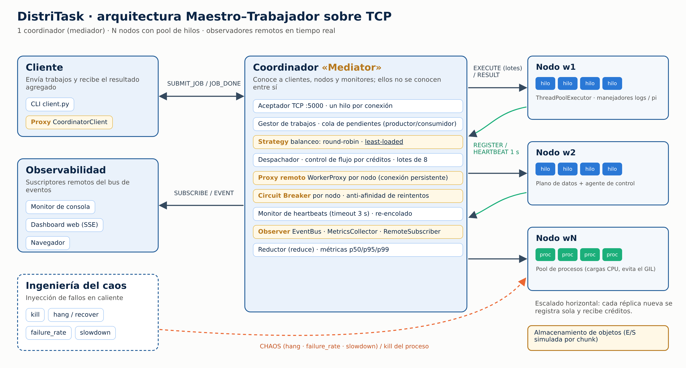

# DistriTask — procesamiento paralelo distribuido entre hilos y nodos

Prototipo del mini proyecto **"Tejiendo redes: Arquitectura de software entre hilos y nodos"**
(Arquitectura de Software, Unidad 2).

DistriTask es un sistema **Maestro–Trabajador** escrito en Python (solo biblioteca estándar):
un **coordinador** recibe trabajos, los divide en tareas y las reparte por TCP entre **nodos
trabajadores**, cada uno con un **pool de hilos** (o de procesos). El caso de uso es el
**análisis distribuido de logs** de una plataforma de microservicios (fase *map* en los nodos,
fase *reduce* en el coordinador). También incluye una carga CPU pura (π por Monte Carlo) para
estudiar el GIL de CPython.



> Autor: **Jhon Fredy Carreño Pinto** · Institución: **Tecnologica del oriente** · Video: **[ENLACE YOUTUBE]**

---

## Patrones de diseño aplicados

| Patrón | Dónde | Para qué |
|---|---|---|
| **Mediator** | `coordinator.py` → `Coordinator` | Clientes, nodos y monitores solo hablan con el coordinador: acoplamiento *n + m* en lugar de *n × m*. |
| **Proxy remoto** | `proxy.py` → `WorkerProxy`, `client.py` → `CoordinatorClient` | El nodo remoto se usa como un objeto local; el proxy oculta sockets, serialización, lotes, créditos y reconexión. |
| **Observer distribuido (Pub/Sub)** | `events.py` → `EventBus`, `RemoteSubscriber`; `monitor.py`, `dashboard.py` | Eventos por tema (`worker.down`, `breaker.opened`…) hacia observadores locales y remotos, sin bloquear al coordinador. |
| **Strategy** | `strategies.py` | Balanceo intercambiable: `round_robin`, `least_loaded`, `random`. |
| **Circuit Breaker** | `circuit_breaker.py` | Aísla nodos vivos pero degradados (CLOSED → OPEN → HALF_OPEN). |
| **Thread Pool / Productor–Consumidor** | `worker.py`, despachador del coordinador | Concurrencia acotada dentro de cada nodo y desacople entre recepción y despacho. |

## Estructura

```
distritask/
├── distritask/
│   ├── protocol.py        # marcos TCP: 4 bytes de longitud + JSON UTF-8
│   ├── coordinator.py     # Mediator: planificación, heartbeats, reintentos, reduce
│   ├── worker.py          # nodo: plano de datos + plano de control + pool de hilos
│   ├── proxy.py           # Proxy remoto de cada nodo (créditos, lotes, breaker)
│   ├── circuit_breaker.py # Circuit Breaker
│   ├── strategies.py      # Strategy de balanceo
│   ├── events.py          # Observer distribuido
│   ├── metrics.py         # métricas y percentiles
│   ├── tasks.py           # cargas (logs, pi) y agregación (reduce)
│   ├── client.py          # cliente CLI / proxy del coordinador
│   ├── monitor.py         # monitor de consola (observador remoto)
│   ├── dashboard.py       # panel web en tiempo real (SSE, sin dependencias)
│   ├── chaos.py           # inyección de fallos en caliente
│   └── cluster.py         # lanzador de clúster local (procesos independientes)
├── scripts/
│   ├── demo.py            # demostración guiada en un comando
│   ├── benchmark.py       # experimentos E1–E8
│   └── plot_results.py    # gráficas a partir de los resultados
├── tests/                 # 30 pruebas (unitarias + integración con procesos reales)
├── docs/diagrams/*.puml   # diagramas UML (PlantUML)
├── docs/img/              # diagramas y gráficas renderizados
├── results/               # resultados crudos de los benchmarks (JSON)
├── Dockerfile, docker-compose.yml
└── requirements.txt       # solo matplotlib (opcional, para las gráficas)
```

## Requisitos

* Python **3.10 o superior** (probado con 3.13). No hay dependencias para ejecutar el sistema.
* Opcional: `pip install -r requirements.txt` para regenerar gráficas.

## Inicio rápido (un solo comando)

```bash
python scripts/demo.py                              # 1 coordinador + 3 nodos, 400 tareas de logs
python scripts/demo.py --dashboard --pause          # abre http://127.0.0.1:8080 y espera Enter
python scripts/demo.py --kill w2 --at 1.0           # caída abrupta de un nodo a mitad del trabajo
python scripts/demo.py --hang w2 --at 1.0 --recover-after 4 --keep   # cuelgue + recuperación
python scripts/demo.py --degraded w3                # nodo degradado -> Circuit Breaker
python scripts/demo.py --profile baseline --slow w3 # versión 1 con un nodo lento
python scripts/demo.py --job pi --executor process  # carga CPU con pool de procesos
```

En Windows usa `py` en lugar de `python` si es necesario.

## Ejecución manual (una terminal por componente)

```bash
# Terminal 1 - coordinador
python -m distritask.coordinator --port 5000 --profile optimized
# Terminales 2, 3, 4 - nodos
python -m distritask.worker --id w1 --coordinator 127.0.0.1:5000 --threads 4
python -m distritask.worker --id w2 --coordinator 127.0.0.1:5000 --threads 4
python -m distritask.worker --id w3 --coordinator 127.0.0.1:5000 --threads 4 --slowdown 3
# Terminal 5 - observadores
python -m distritask.monitor --stats
python -m distritask.dashboard            # http://127.0.0.1:8080
# Terminal 6 - cliente
python -m distritask.client logs --chunks 400 --lines 1000 --io-latency 50
python -m distritask.client logs --file ruta/a/un/archivo.log     # logs reales
python -m distritask.client pi --tasks 40 --samples 500000
python -m distritask.client stats
# Inyección de fallos en caliente
python -m distritask.chaos w2 hang
python -m distritask.chaos w2 recover
python -m distritask.chaos w3 failure_rate 1.0
```

Los nodos pueden correr en otras máquinas: inicia el coordinador con `--host 0.0.0.0` y los
nodos con `--bind 0.0.0.0 --coordinator IP_DEL_COORDINADOR:5000`.

## Versión 1 vs. versión 2

| Ajuste | V1 (`--profile baseline`) | V2 (`--profile optimized`, por defecto) |
|---|---|---|
| Transporte | una conexión TCP por tarea | conexión persistente por nodo |
| Envío | 1 tarea por mensaje | lotes de hasta 8 tareas |
| Créditos | 8 por hilo | 2 por hilo |
| Balanceo | round-robin | least-loaded (utilización y latencia EWMA) |
| Nodo degradado | sin protección | Circuit Breaker + anti-afinidad de reintentos |

## Resultados (host de 2 vCPU, Python 3.13, mediana de 3 corridas)

| Experimento | Resultado principal |
|---|---|
| E1 Hilos por nodo | 18,8 → 171 tareas/s de 1 a 16 hilos (casi lineal hasta 8; luego satura CPU/GIL). |
| E2 Nodos | 73 → 445 tareas/s de 1 a 8 nodos; eficiencia 98 % (2 nodos) y 76 % (8 nodos). |
| E3 CPU pura | Hilos: 12,9 → 11,8 t/s (el GIL no escala). Procesos o nodos: ×1,9–2,0, justo el límite de 2 vCPU. |
| E4 V1 → V2 | Nodo lento: **+36 %** throughput. Tareas finas: **×3,0** con conexión persistente. |
| E5 Fallos | 600/600 tareas en todos los casos; detección por cierre TCP ≈ 1–3 ms, por heartbeat ≈ 2,9 s; V2 re-encola 8 tareas vs. 29–32 en V1. |
| E6 Nodo degradado | Sin protección: 24/360 tareas. Con anti-afinidad: 360/360 (344 intentos perdidos). Con Circuit Breaker: 360/360 (11 intentos perdidos). |
| E7 Créditos | 2 créditos/hilo es el mejor valor con nodos heterogéneos; 8 con tareas muy finas. |
| E8 Fallos en caliente | Defecto del breaker encontrado y corregido (v2.1): tareas perdidas 4, 0, 8, 3, 2 → 0 en 5/5 corridas. |

Reproducir: `python scripts/benchmark.py` (≈10 min) y luego `python scripts/plot_results.py`.

## Pruebas

```bash
python -m unittest discover -s tests -t . -v
```

## Docker (opcional, simula la red de la nube)

```bash
docker compose up --build --scale worker=4
docker compose run --rm client logs --chunks 400
# Dashboard: http://localhost:8080
```

## Protocolo

Mensajes JSON con prefijo de longitud (4 bytes, big-endian) sobre TCP:
`REGISTER`, `HEARTBEAT` (control) · `EXECUTE`, `RESULT` (datos) · `SUBMIT_JOB`, `JOB_ACCEPTED`,
`JOB_DONE`, `STATS` (clientes) · `SUBSCRIBE`, `EVENT` (observadores) · `CHAOS` (pruebas).

## Limitaciones conocidas

* El coordinador es un punto único de fallo (mejora futura: réplica pasiva y elección de líder).
* Semántica de ejecución *al menos una vez*: las tareas deben ser idempotentes.
* Un hilo por conexión en el coordinador; para miles de nodos convendría `asyncio`.
* Sin cifrado ni autenticación (TLS y tokens quedan fuera del alcance del prototipo).